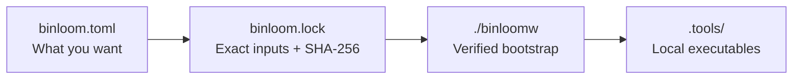

<p align="center">
  
</p>

<h1 align="center">🧶 Binloom</h1>

<p align="center">
  <strong>Pinned, checksum-verified developer tools that live with your repository.</strong>
</p>

<p align="center">
  <a href="https://github.com/KyrboForge/binloom/actions/workflows/ci.yml"></a>
  <a href="https://github.com/KyrboForge/binloom/releases/latest"></a>
  <a href="https://crates.io/crates/binloom"></a>
  <a href="LICENSE-MIT"></a>
</p>

Binloom is a small, repository-local manager for developer tools distributed
as release binaries or crates.io packages. It gives every contributor and CI
job the same pinned executables without a global Binloom installation.

It works the same way in Rust, Go, Python, JavaScript, Java, and mixed
repositories.

**No global installs. No language lock-in. No version drift.**

## 📦 Installation

### Bootstrap without a global install

The recommended bootstrap downloads a temporary, checksum-verified Binloom
binary and runs the requested command without installing anything globally:

```sh
curl -fsSL https://raw.githubusercontent.com/KyrboForge/binloom/main/bootstrap.sh \
  -o /tmp/binloom-bootstrap
sh /tmp/binloom-bootstrap init
rm /tmp/binloom-bootstrap
```

### Optional global install

If you want `binloom` available everywhere, choose one of these:

#### crates.io

```sh
cargo install binloom
```

#### Git repository

```sh
cargo install --git https://github.com/KyrboForge/binloom
```

🚧 Homebrew support through `KyrboForge/tap` is in progress.

Global Binloom is convenient for commands such as `binloom init`. The
committed `binloomw` still uses the version pinned by the repository so every
contributor and CI job runs the same binary. Contributors therefore only need
`./binloomw`, not a global installation.

## ✨ Why Binloom?

Projects often need command-line tools that are not application dependencies:
hook runners, linters, formatters, code generators, and protocol compilers.
Installing and aligning them globally creates onboarding work and CI drift.

Binloom keeps the whole flow reproducible and local:



The manifest describes intent. The committed lockfile records exact versions
and checksums. Release sources also record artifact URLs, formats, and checksum
provenance. Downloads are verified before installation.

## 🚀 Quick start

The maintainer initializes the repository using any available Binloom binary:

```sh
binloom init
binloom add lefthook \
  --source github:evilmartians/lefthook \
  --version 2.1.11
binloom update --self

git add binloomw binloom.toml binloom.lock .gitignore
```

Contributors only need the committed files:

```sh
./binloomw exec lefthook -- run pre-commit
```

`binloomw` downloads the Binloom version pinned for the current platform,
verifies its SHA-256 checksum, caches it under
`.tools/binloom/<version>/binloom`, and forwards the command. No global
installation or shell setup is required. The cached binary is re-verified
against `binloom.lock` on every run, not just when a marker file matches.

When a command names a declared tool, `binloomw exec` installs its pinned
version on first use and re-hashes the cached executable (and its retained
archive) on later runs, repairing a modified or non-executable cache and
failing closed if it cannot. An intact cache works offline. See
[Cache verification](docs/design.md#cache-verification) for the guarantees and
limits.
`binloomw install` installs declared tools for the host target. Both put executables under
`.tools/<tool>/<version>/` and link them into `.tools/.bin`. To use that path
for a single shell command:

```sh
PATH="$(./binloomw path):$PATH" lefthook version
```

## Shell activation

For one shell session, explicitly prepend this project's absolute `.tools/.bin`:

```sh
# Bash (use --shell zsh in Zsh)
eval "$(./binloomw env --shell bash)"
```

```fish
./binloomw env --shell fish | source
```

Repeated activation does not add another entry when it is already first. This
manual mode does not check trust or undo PATH changes when you leave the project;
restore your previous PATH or start a fresh shell to deactivate it. For scripts
and CI, `./binloomw exec <command>` keeps activation scoped to one process.

For automatic activation, the first successful interactive `./binloomw install`
in Bash, Zsh, or Fish asks once:

```text
Enable automatic project-local commands in your shell? [y/N]
```

Answering `y` trusts the current project and appends a marked block to `~/.bashrc`,
`${ZDOTDIR:-~}/.zshrc`, or `${XDG_CONFIG_HOME:-~/.config}/fish/config.fish`,
selected from `$SHELL`. Bash also configures the first existing login file among
`~/.bash_profile`, `~/.bash_login`, and `~/.profile`, creating `~/.bash_profile`
if none exists. The hook initializes only once when both Bash files are read.
Existing contents and permissions are preserved; an existing profile gets a sibling
`.binloom.bak` backup before atomic replacement. `HOME`, `ZDOTDIR` and `XDG_CONFIG_HOME`
are resolved like the shell does; symlinked profile files or directories below them
are rejected. Setup copies the executable to `$XDG_CONFIG_HOME/binloom/bin/binloom`
(default `~/.config/binloom/bin/binloom`) and pins that stable path in the block, so
moving or deleting the setup project does not break activation. If the copy is
missing, interactive shells warn; run `./binloomw install` in a Binloom project to
restore it after previously consenting.

Open a new shell or source the updated profile to enable it. A child process
cannot change the PATH of the shell that ran `install`. Answering anything other
than `y` declines; the answer is remembered in
`$XDG_CONFIG_HOME/binloom/activation-prompt` (default
`~/.config/binloom/activation-prompt`). `install --no-prompt`,
`BINLOOM_NO_PROMPT=1`, unsupported shells, and noninteractive installs skip setup
without editing a profile or recording an answer.

You can also configure the hook explicitly by putting the output of
`binloom shell init --shell bash` (or `zsh` / `fish`) in your rc file. To try it
in the current shell, use `eval "$(./binloomw shell init --shell bash)"`, or
`./binloomw shell init --shell fish | source` in Fish. Trust projects explicitly:

```sh
./binloomw shell trust             # nearest project, including from a subdirectory
binloom shell trust /path/to/repo   # canonicalizes the root
./binloomw shell status
./binloomw shell untrust
```

The hook checks only when the working directory changes. It finds the nearest
ancestor containing `binloom.toml` and activates it only if its canonical root
appears in `$XDG_CONFIG_HOME/binloom/trusted` (default
`~/.config/binloom/trusted`). The directory is created with mode `0700`, and the
trust and answer files with `0600`. An untrusted nested project does not inherit
its parent's trust. Interactive shells show at most one trust hint per root per
session; noninteractive hooks stay quiet.

Trust lets the project's commands shadow system commands; it does not sandbox
their execution. The hook never runs repository scripts or downloads tools.
The `.tools/.bin` directory must exist and resolve inside the trusted root;
symlink escapes are rejected. On project switches or exit, only the PATH entry
added by the hook is removed, preserving other entries and user PATH changes.
Trust changes take effect on the next directory change. Activation paths must
be UTF-8 and cannot contain colons or newlines.

After installation, `.tools/.bin/binloom` points to
`../binloom/<locked-version>/binloom` when that cached binary exists. An activated
shell therefore uses the project's pinned Binloom as well as its tools. Run
`./binloomw install` after a Binloom version update to refresh this link. The
tool name `binloom` is reserved: installation rejects `[tools.binloom]` rather
than overwriting that tool with the manager.

To disable automatic activation, remove the rc block between
`# >>> binloom shell activation >>>` and `# <<< binloom shell activation <<<`,
then start a new shell. You can restore the sibling backup if needed. Remove
the `activation-prompt` file to allow the install question again, and use
`shell untrust` to revoke individual projects. Manual hooks can be removed from
the rc file in the same way. `./binloomw` and `exec` keep working without hooks.

Windows is currently unsupported; native Windows support is tracked in
[#35](https://github.com/KyrboForge/binloom/issues/35).

## ⚙️ Configuration

`binloom.toml` stays intentionally small:

```toml
#:schema https://raw.githubusercontent.com/KyrboForge/binloom/main/schemas/binloom.schema.json

manifest-version = 1

[binloom]
version = "0.2.0"

[tools.lefthook]
version = "2.1.11"
source = "github:evilmartians/lefthook"
```

Supported source formats are:

- `github:owner/repository`
- `gitlab:group[/subgroup]/project`
- `cargo:package`

GitLab projects may use nested groups. `GITLAB_TOKEN` optionally authenticates
GitLab API requests through the `PRIVATE-TOKEN` header. Public repositories are
supported; private asset downloads are not.

GitHub and GitLab sources use prebuilt release assets. Automatic matching keeps
assets that name the tool, the OS, and the architecture, then prefers a plain
name, a single-file `.gz`, and a raw executable over a `.tar.gz`/`.tgz` archive
that might not contain the tool binary; every dropped candidate is reported as
a warning. When that is still ambiguous, an optional pattern can select one
asset for each platform:

```toml
[tools.example]
version = "1.2.3"
source = "github:owner/example"
asset = "example_{version}_{os}_{arch}.gz"
```

Binloom tries `v{version}`, `{version}`, `{tool}-{version}`, and
`{tool}-v{version}` release tags.
`binloom add` accepts any of those spellings, such as `--version v4.54.3` or
`--version jq-1.8.2`, and stores the bare version in `binloom.toml`.
The `v` spellings are only tried for versions that start with a digit, so a
`nightly` version never resolves a `vnightly` tag.
`{os}` matches `macos`/`darwin` and `linux`; `{arch}` matches `aarch64`/`arm64`
and `x86_64`/`amd64`/`x64`/`x86-64`. Every platform in the lockfile must
resolve to its own asset: a pattern that names a single platform, such as
`example_{version}_darwin_arm64.tar.gz`, or an asset that is shared across
platforms is rejected instead of locking the wrong binary for other targets.
The only accepted sharing is one macOS universal binary for both macOS targets,
and its name must say `universal`.
`{target}` expands to a Rust target triple such as
`x86_64-unknown-linux-gnu`. For example,
cargo-nextest can use its prebuilt releases without requiring Rust:

```toml
[tools.cargo-nextest]
version = "0.9.143"
source = "github:nextest-rs/nextest"
asset = "cargo-nextest-{version}-{target}.tar.gz"
```

```sh
./binloomw install
./binloomw exec cargo nextest run
```

Cargo sources download a versioned `.crate` archive from crates.io, verify its
SHA-256 checksum, and compile it locally with `cargo install --locked`. They
require both `cargo` and `rustc`, and the package must install a binary matching
the configured tool name. The checksum identifies the source archive, not the
compiled bytes, so a locally built binary is only checked against the digest
recorded at build time (corruption detection, not authenticity):

```toml
[tools.cargo-nextest]
version = "0.9.143"
source = "cargo:cargo-nextest"
```

Prefer GitHub or GitLab when suitable prebuilt binaries are available. The
`asset` field is valid only for those release sources.

Updates ignore releases younger than 24 hours by default. Repositories can
change that safety window:

```toml
[update]
minimum-release-age-minutes = 1440
```

### Platform targets

Without `[platforms]`, tools are locked for the four legacy targets
`macos-aarch64`, `macos-x86_64`, `linux-aarch64`, and `linux-x86_64`.
The legacy Linux IDs match by OS and architecture alone and still expand
`{target}` to a musl triple. They retain that meaning in manifests and locks.

Projects can also declare `linux-aarch64-gnu`, `linux-aarch64-musl`,
`linux-x86_64-gnu`, and `linux-x86_64-musl`. Tools inherit the project
targets and can narrow them to a subset.

```toml
[platforms]
targets = ["linux-x86_64-gnu", "linux-x86_64-musl"]

[tools.example]
version = "1.2.3"
source = "github:owner/example"
# Inherits both project targets.

[tools.gnu-only]
version = "1.0.0"
source = "github:owner/gnu-only"
targets = ["linux-x86_64-gnu"]
```

Target lists must be nonempty and contain unique supported IDs. Tool targets
require `[platforms]`. A list cannot mix a legacy Linux ID with an explicit
ABI for the same architecture. Each required target must resolve to an asset.
Narrow a tool to the ABI its upstream publishes, or use an explicit asset
pattern to identify a compatible build whose filename omits the ABI.

For explicit Linux targets, automatic matching requires a standalone `gnu`,
`glibc`, or `musl` token in the asset name. A generic `linux` asset needs an
explicit pattern that asserts compatibility. A matching ABI label identifies
only the libc family. A `musl` suffix does not guarantee static linking. A
`gnu` suffix declares no minimum glibc version. Neither guarantees that
required shared libraries are present or that the binary runs on every
distribution.

On a supported project host, `install` skips tools that exclude the detected
target. `exec` rejects an excluded tool and names the detected target. An
unavailable declared tool never falls back to a same-named binary on `PATH`.
A host outside the project targets fails before installation changes. See
[Linux target detection](docs/design.md#linux-target-detection).

Both file versions stay at 1. There is no migration command. `install` and
`exec` leave existing locks intact and direct you to `binloom update` when a
required lock is missing or stale. Run `binloom update` after changing
targets.

Binloom releases before target support reject these fields. Upgrade the pinned
Binloom and its wrapper first (`binloomw update --self`), commit, and only then
add `[platforms]` and run `binloomw update` to regenerate the lock. The
wrapper's own Binloom bootstrap still selects the legacy `linux-*` artifact
keys and is not ABI-aware; see
[#38](https://github.com/KyrboForge/binloom/issues/38).

## 🧰 Commands

| Command | Purpose |
| --- | --- |
| `binloom init` | Create missing manifest, lock and wrapper files; add `.tools/` to `.gitignore` |
| `binloom add <name> --source <source> --version <version> [--asset <pattern>]` | Append a tool, refresh the lockfile, and install it |
| `binloom install` | Install locked tools compatible with the host target |
| `binloom update [tool]` | Update one tool, or all tools and Binloom when omitted |
| `binloom update --self` | Update only Binloom and its wrapper metadata |
| `binloom exec <command> [args...]` | Install the requested declared tool on demand and run with `.tools/.bin` prepended to `PATH` |
| `binloom list` | List configured tools and versions |
| `binloom path` | Print the absolute `.tools/.bin` path |
| `binloom env --shell <bash\|zsh\|fish>` | Print commands for manual PATH activation |
| `binloom shell init --shell <bash\|zsh\|fish>` | Print directory-change hooks |
| `binloom shell trust [path]` / `untrust [path]` | Grant or revoke project activation |
| `binloom shell status` | Show the current project's trust status |

Project commands find the nearest parent directory containing
`binloom.toml`, so they also work from project subdirectories.

Updates modify `binloom.toml` and `binloom.lock`. Commit both so contributors
and CI receive the same toolchain.

## 📁 Repository files

| Path | Purpose | Commit? |
| --- | --- | --- |
| `binloomw` | Generated POSIX bootstrap wrapper | yes |
| `binloom.toml` | Human-written requirements | yes |
| `binloom.lock` | Resolved versions, inputs, checksums, and provenance | yes |
| `.tools/` | Downloaded binaries and links | no |

When `[wrapper]` metadata is present in the lockfile, `binloomw` also verifies
its generated version and checksum. A changed or outdated wrapper replaces
itself atomically from the locked release asset and restarts.

## 🎯 Scope

Binloom currently supports public GitHub and GitLab Releases plus public
crates.io packages. Release assets may be raw executables, gzip-compressed
executables, or `.tar.gz`/`.tgz`, `.tar.xz`/`.txz`, `.zip`, `.tar.zst`/`.tar.zstd`,
and `.tar.bz2`/`.tbz2` archives holding the tool binary: a regular file named after the tool, or the
archive's only regular file. Archive paths, links, and special files are validated
before extraction; only the selected file is written. Decompression is capped
at 512 MiB: for tar archives across the whole decompressed stream, and for `.zip`
entries and single `.gz` executables per extracted file. Binloom's own bootstrap
assets remain raw or `.gz` only, as supported by `binloomw`. Cargo sources require
an existing Rust toolchain and compile the verified crate locally.

It is not a language package manager, runtime manager, daemon, GUI, or remote
package registry. See the [MVP design](docs/design.md) for the detailed
contract.

## 🧪 Development

Run the test suite and measure line coverage locally with:

```sh
rustup component add llvm-tools-preview
cargo install cargo-llvm-cov
rustup run stable cargo llvm-cov --all-targets --locked --summary-only
```

CI rejects changes that lower line coverage below 60% and uploads the report
to GitHub Code Quality.

Linux ABI tests simulate x86_64 GNU and musl loader evidence. The real-host
install and exec test was exercised in aarch64 GNU and musl containers for
[#37](https://github.com/KyrboForge/binloom/issues/37).

## 📜 License

Licensed under either [MIT](LICENSE-MIT) or
[Apache License 2.0](LICENSE-APACHE), at your option.
